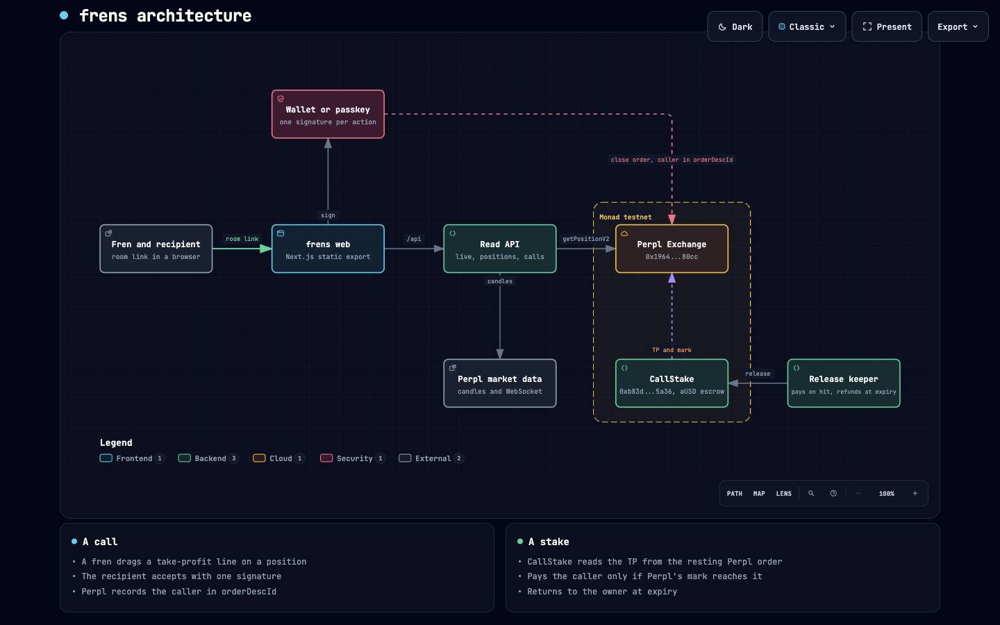

# frens

A fren calls the exit on your Perpl position, you accept with one signature, and the caller is paid only if Perpl's mark hits.

**Live:** https://frenstrade.vercel.app/?net=testnet (Monad testnet; Testnet and Mainnet switch at the top right)

**Room with a call waiting:** the link in [docs/try-it.md](docs/try-it.md) opens four frens on one BTC chart, a call record and an open call. No wallet, no sign-up.

## The 90-second loop

1. **See friends on one chart.** Each fren is a face pinned to the candle where they entered, with side and live PnL in the rail. Positions are decoded from Perpl's Exchange contract at the latest block (the room footer prints the block).
2. **Send a call.** Pick a fren, drag the take-profit or stop-loss line to the price you would take, copy the link.
3. **Accept with one signature.** Your fren opens the link, sees your face on a ghost line, and taps Accept. A browser wallet or a passkey account made inside frens signs once. The call becomes a resting Perpl close order on their own position, with your address written into the order's `orderDescId`. A take-profit already resting is replaced in the same signature.
4. **Back it with a stake.** The owner stakes aUSD on the call. `CallStake` reads the TP from the resting Perpl order itself and pays the caller only if Perpl's mark reaches it before expiry. Otherwise the stake returns to the owner.
5. **Copy a fren.** Pick any live position, set your own size and maximum slippage, and sign one order. Perpl records which fren you copied.

## Architecture

Interactive version: [docs/architecture.html](docs/architecture.html).

## How it works

### Contracts (Monad testnet, deployments in `contracts/deployments.json`)

| Contract | Address | Role |
|---|---|---|
| CallStake | `0xb83d69657eed4abd327b3539f24f07556c1a5a36` | aUSD escrow behind a call. `stake` reads side, TP and owner from the resting Perpl order, and requires the TP at least 50 bps from Perpl's mark. `release` pays the caller once the mark reaches the TP; `refund` returns the stake after expiry. |
| Perpl Exchange | `0x1964C32f0bE608E7D29302AFF5E61268E72080cc` | Perpl's own contract. Positions, resting orders and fills are read from it; calls and copies are orders sent to it. |
| aUSD | `0xa9012a055bd4e0eDfF8Ce09f960291C09D5322dC` | The stake token. |

`CallStake` is covered by unit, fuzz and fork tests against Perpl's testnet Exchange.

### Off-chain parts

- **`web/`**: Next.js app, exported as static files. `lib/readPosition` decodes positions from `getPositionV2`; `lib/suggest` builds call payloads and close orders; `lib/receipts` reads call records from receipts; `lib/callhit` finds hits from candles; `lib/resting` finds live TPs through `getPerpOrderLocks`; `lib/copy` builds the copier's order with Perpl builder id 23; `lib/onboard` opens a Perpl account; `lib/passkey` creates the passkey wallet; `lib/roomfeed` pushes live trades as toasts; `lib/marketws` follows Perpl's candle WebSocket.
- **`web/app/api/`**: read routes for live traders, positions, candles and the call book, plus an allowlisted relay for Perpl's API.
- **`demo/release-keeper.ts`**: watches `Staked` events and calls `release` the moment the mark crosses, and `refund` after expiry. Both are permissionless, so the keeper needs only gas.
- **`src/`**: command-line readers and the order encoder the web app was built from.

## Proof

Every row is a transaction with status success on Monad testnet, re-read from the RPC.

| Claim | Transaction |
|---|---|
| Browser-wallet copy from a fren's live 0.001 BTC long: recipient chose 0.0005 BTC and 50 bps max slippage; Perpl recorded the fren in `OrderRequestV2`, builder 23 in `TakerOrderFilledV2`, and the recipient position read back at 0.0015 BTC | [0x2754d959](https://testnet.monadexplorer.com/tx/0x2754d959068c9eb80cc593d3e1517eb6953a65970dd878001a3076905c0c70fd) |
| A call taken and filled (a hit), caller read back from `orderDescId` | [0x7bff5155](https://testnet.monadexplorer.com/tx/0x7bff515503e590a5fb6831f9dd89051cd6f03448389808f798d2b121bd50eb5a) |
| A call that replaced a resting TP in one batch | [0xeb51040c](https://testnet.monadexplorer.com/tx/0xeb51040c5bc7cd08695750d237eed7d3cef3a80b0d18e976c19bbcdb5814d2e4) |
| A passkey wallet created in the browser, Perpl account opened in frens, fren copied | [0x9801c9cb](https://testnet.monadexplorer.com/tx/0x9801c9cb20fc3a901c59d24b0d2862ef333a6c45e7fb8ddb27f77cd4a826ef93) |
| The same passkey wallet taking a fren's call from the chart | [0x2d17f22d](https://testnet.monadexplorer.com/tx/0x2d17f22d7081323c6a2e3146091ba51b19cb55ffd9530305801fb7cdd5bbc120) |
| A copy carrying Perpl builder id 23, read from `TakerOrderFilledV2` | [0xf5c94fd1](https://testnet.monadexplorer.com/tx/0xf5c94fd1580411907a723155057a50971c555824e8d19a7257fb084fe44afed0) |
| CallStake deployed (first deployment `0x0E8CbE0902067a49d98961A1440419AEcAf0C5Bc`) | [0xbb66d0db](https://testnet.monadexplorer.com/tx/0xbb66d0dbcd0a760c5b5d017500b95baab4ebfa620f1d538b00d9b30e9a468325) |
| A stake on cy's call, TP read from bo's resting Perpl order | [0xc6913d2e](https://testnet.monadexplorer.com/tx/0xc6913d2e44066a12a43e57b1edd1dee2d6440c822b648ef6bc5144b8ce1ee861) |
| That stake paid to cy when Perpl's mark reached the TP, released by the keeper | [0xddd2eb14](https://testnet.monadexplorer.com/tx/0xddd2eb149c72fa4e1916c07cdfc479dbb68a7f626e72e6c1033444a3220671af) |
| CallStake with the 0.5% minimum distance deployed (`0xb83d6965...5a36`) | [0xc3a16d6e](https://testnet.monadexplorer.com/tx/0xc3a16d6e3de6879ca2bd4dc00698aaff4b1f3058e0757b6c1c0dadda0a0bb98e) |
| A stake on that deployment paid to cy when the mark reached 87,085.0 | [0x448e4838](https://testnet.monadexplorer.com/tx/0x448e48381795d71f9f2e897a23da3763d0e91fd42e666ef553f3c5fabd2ca910) |

Re-check any row yourself:

    bun run demo/check-hit.ts <tx>              # decodes the caller and checks the hit against Perpl's candles
    bun run demo/adoption.ts testnet <hours>    # counts orders carrying a frens orderDescId
    cast receipt <tx> --rpc-url https://testnet-rpc.monad.xyz

The per-feature evidence, with the transaction behind each user action, is in [docs/feature-matrix.md](docs/feature-matrix.md).

## Run it

    cd web && bun install && bun run dev       # the app on your machine
    cd web && bun test                          # 373 tests: chain decoding, order encoding, call records
    cd contracts && forge test                  # CallStake unit, fuzz and fork tests
    # web/.env.local: MONAD_RPC_URL and MONAD_TESTNET_RPC_URL for the server-side live view

## Layout

    contracts/   CallStake.sol, tests, deployments.json
    web/         the app: chart room, call banner, passkey wallet, read API routes
    demo/        scripts that seed and drive the testnet demo room with real transactions
    src/         command-line position reader and order encoder
    spike/       the first proofs, including the caller surviving on chain in orderDescId
    docs/        architecture, feature matrix, try-it guide

Built for the Monad hackathon, Track 03: Social, Attention & Culture.
